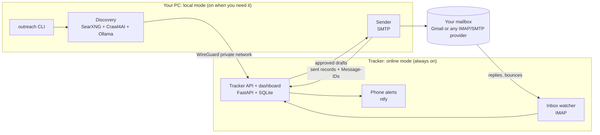

# OutreachAI

[](LICENSE)

A free, fully open-source system that helps a YouTube creator ask brands for review units. It finds brands for a product type, finds each brand's published contact channel, prepares a personalised email for each one, sends only the emails you approve, and tracks replies, bounces, opt-outs and follow-ups.

**Status (31 October 2026):**

- **v0 starter kit**: usable now (Google Sheets + Apps Script + a Python discovery script). Setup guide [below](#v0-starter-kit-setup).
- **v1**: fully open source, two-node design (your PC + an always-on tracker). Designed in [docs/](docs/), not implemented yet.

## Repository layout

```
automail/
├── README.md          this file (the only README)
├── CLAUDE.md          instructions and reading order for AI coding assistants
├── LICENSE, NOTICE    Apache-2.0 and third-party credits
├── apps-script/       v0: Google Sheets outreach script
├── discovery/         v0: Python brand and contact discovery
├── docs/              v1 design: research, options, decisions (01–09)
└── context/           working brief for contributors and AI: overview, architecture,
                       UI, code standards, workflow rules, progress tracker, specs/
```

## v1 design

- **Local mode** (your PC, when you turn it on) does the heavy work: brand discovery, contact extraction, AI, sending.
- **Online mode** (a small always-on tracker) does only **tracking**: replies, bounces, opt-outs, follow-up reminders. It never finds contacts and never sends email.



### Key decisions

1. **The tracker's database is the single source of truth.** The PC reads and writes it over a private network, so there's no two-way sync and no merge conflicts.
2. **Email goes over open standards (SMTP and IMAP), not a vendor API.** Gmail works through an app password, and any other provider works the same way.
3. **Replies are matched by the standard `Message-ID` / `In-Reply-To` headers**, not Gmail thread IDs.
4. **Everything we run is OSI-licensed.** Proprietary services are optional adapters, never required.
5. **Fail closed.** If the PC cannot reach the tracker, it refuses to send.

### Design documents

| # | Document | What it answers |
|---|---|---|
| 1 | [Goals and principles](docs/01-goals-and-principles.md) | What the system must do, what "completely open source" means here, the safety rules that never change |
| 2 | [Architecture](docs/02-architecture.md) | The two nodes, what runs where, how local mode hands over to online mode |
| 3 | [Technology choices](docs/03-technology-choices.md) | Every component, options compared, licenses, decisions |
| 4 | [Data model and sync](docs/04-data-model-and-sync.md) | The database, who owns which data, how PC and tracker stay in step |
| 5 | [Email sending and tracking](docs/05-email-sending-and-tracking.md) | SMTP, IMAP, threading, bounces, replies, follow-ups, limits |
| 6 | [Discovery pipeline](docs/06-discovery-pipeline.md) | Finding brands and contacts with no paid or closed services |
| 7 | [Deployment and security](docs/07-deployment-and-security.md) | Where the tracker runs, private networking, secrets, backups |
| 8 | [Licensing and compliance](docs/08-licensing-and-compliance.md) | Project license, dependency licenses, attribution, outreach law |
| 9 | [Roadmap](docs/09-roadmap.md) | Milestones, migration from v0, open questions |

## For contributors and AI assistants

`docs/` is the **design** (the *why*). `context/` is the **working brief**: the current decisions, rules to follow, and a record of what was actually built and verified. When they disagree, `context/` wins for implementation; fix the mismatch in the same change.

### Reading order

The same order is in [CLAUDE.md](CLAUDE.md), which AI coding assistants load automatically. Keep the two in step.

1. [Project overview](context/project-overview.md)
2. [Architecture](context/architecture.md)
3. [UI context](context/ui-context.md) (if the task touches the dashboard or CLI output)
4. [Code standards](context/code-standards.md)
5. [Workflow rules](context/ai-workflow-rules.md)
6. [Progress tracker](context/progress-tracker.md)
7. The relevant spec in [context/specs/](context/specs/)

### Context files

| File | What it holds |
|---|---|
| [project-overview.md](context/project-overview.md) | What OutreachAI is, who uses it, journeys, features, scope, success criteria |
| [architecture.md](context/architecture.md) | Stack, folder layout, PC/tracker boundaries, data models, auth, integrations, business rules |
| [ui-context.md](context/ui-context.md) | Look and behaviour of the tracker dashboard and the CLI output |
| [code-standards.md](context/code-standards.md) | Naming, structure, typing, validation, errors, API style, migrations, tests |
| [ai-workflow-rules.md](context/ai-workflow-rules.md) | How an AI assistant must work in this repo: scope, safety, verification |
| [progress-tracker.md](context/progress-tracker.md) | Current goal, done, in progress, blockers, decisions, test results, dated notes |
| [specs/](context/specs/) | One file per feature or milestone task, written before the work starts |

| Spec | Milestone |
|---|---|
| [01-open-source-foundation.md](context/specs/01-open-source-foundation.md) | M0: license, notices, repo layout, CI |
| [02-tracker-service-and-auth.md](context/specs/02-tracker-service-and-auth.md) | M1: tracker API, database, API token and dashboard login |
| [03-send-and-track-slice.md](context/specs/03-send-and-track-slice.md) | M2: send over SMTP from the PC, detect the reply on the tracker |

### Documentation update rules

- **Main context files describe the system as it is meant to be now.** Change them in the same commit as the code that changes the design.
- **Specs describe one piece of work.** Write or update the spec *before* implementing. Once it's done, mark its status `Done` and leave it unchanged except to fix errors.
- **The progress tracker records what really happened**: what was built, what was tested, and how. Never mark something verified that was not run.
- New spec files are numbered in order: `NN-short-name.md`. Copy the section list from an existing spec.
- Dates use `YYYY-MM-DD`. Times are IST unless stated.
- This is the project's only README. Don't add READMEs inside folders; put folder descriptions here.

---

## v0 starter kit setup

Two parts:

| Part | What it does | Runs where |
|---|---|---|
| `discovery/discover.py` | Finds brands for a product type, opens their own websites, pulls the published contact email (or form, creator program and social links), checks the MX record, ranks them, and writes a CSV | Your PC (Python) |
| `apps-script/Code.gs` | Turns a Google Sheet into the outreach tool: previews each email, sends only the rows you approve, daily cap with a slow ramp, one follow-up in the same thread, reply, bounce and opt-out detection, kill switch | Inside your Google account |

Cost: ₹0. Gemini free tier for brand search and classification, Gmail through Apps Script (no Google Cloud project, no OAuth app, no weekly reconnect). v0 relies on Google services; v1 removes that dependency.

### 1. Set up the Google Sheet (10 minutes)

1. Use a **separate Gmail for the channel** (for example `yourchannel.collabs@gmail.com`). Sign in with it.
2. Create a new Google Sheet and name it something like `OutreachAI`.
3. **Extensions > Apps Script**. Delete the sample code and paste in all of `apps-script/Code.gs`.
4. In the Apps Script editor, click **Project Settings** (gear icon), tick **Show "appsscript.json" manifest file in editor**, then open `appsscript.json` and replace it with `apps-script/appsscript.json`. This turns on the Gmail service used for follow-ups and sets the time zone to India.
5. Save, go back to the sheet and reload it. An **OutreachAI** menu appears.
6. **OutreachAI > 1. Set up sheets**. Google asks you to authorize. You will see "Google hasn't verified this app": it is your own script, so click **Advanced > Go to project**. Then run the menu item again.
7. Fill in the **Settings** tab: Your Name, Channel Name, Channel Link, Sample Video.
8. Read the **Template** tab and edit it to sound like you. Placeholders like `{{Brand}}` match any Brands column or Settings name. Every placeholder must have a value or that row will not preview, except `{{Hook}}`, which may be empty.

### 2. Find brands (Python)

```bash
cd discovery
python -m venv .venv
.venv\Scripts\activate
pip install -r requirements.txt
crawl4ai-setup
```

`crawl4ai-setup` downloads a headless Chromium browser (a few hundred MB, one time).

Get a free Gemini API key at https://aistudio.google.com/apikey, then:

```bash
set GEMINI_API_KEY=your-key-here
python discover.py "mechanical keyboard" --max-brands 60
```

Useful options:

- `--seed my_brands.csv`: add brands you already know (columns `name,website`, see `seeds_example.csv`).
- `--no-llm`: no Gemini at all, just crawl the brands in `--seed`.
- `--include-tier-c`: keep marketplace and white-label sellers (hidden by default).
- `--llm-delay 7`: seconds between Gemini calls. Raise it if you hit rate limits.

The run takes a while (roughly 10–30 minutes for 60 brands), mostly because it spaces out Gemini calls to stay inside the free limits.

The output, for example `brands_mechanical_keyboard.csv`, is sorted best-first. Columns:

- **Email / Contact Source**: an address found on the brand's own site, and the page it was on. Nothing is guessed.
- **Email Check**: `MX ok` means the domain accepts mail. It does not prove the mailbox exists.
- **Other Channels**: contact forms, creator/affiliate program pages and socials. Rows without an email need you to act by hand.
- **Tier**: A = established, B = smaller or newer, C = marketplace or white-label.
- **Hook**: one sentence about the brand, written by the AI from its website. **Check every hook before approving.** Delete any that are wrong or bland.

### 3. Send

1. Open the CSV, select everything **except the header row**, copy, and paste into the **Brands** tab at cell A2. The first 12 columns line up.
2. Delete rows you don't want. Fill in any blank **Product Line** cells (needed by the template).
3. **OutreachAI > 2. Build previews**. Each row gets the exact subject and body that would be sent.
4. Read the previews. Tick **Approved** on the ones to send.
5. **OutreachAI > 3. Send approved batch now**. It shows the list and asks you to confirm.
6. Optional: **Turn on daily automation**. Every day at the Send Hour it checks replies, sends due follow-ups, then sends approved emails up to the daily cap. It also checks replies every 6 hours.

**Before real brands, test it:** add a row with your own personal email address, build a preview, approve it, send, reply from your personal account, then run **Check replies and bounces**.

### How the safety rules work

| Rule | How |
|---|---|
| Only approved text is sent | The script sends the stored preview. If the template or row changed, the row becomes `stale` and the approval is cleared. Build previews again and re-approve |
| Daily cap with slow ramp | 10/day in week 1, +5 each week, up to 30 (all in Settings). Follow-ups count toward the cap |
| One email per brand | No second first-email to the same website domain within 60 days |
| Opt-outs | Replies containing "unsubscribe", "remove me", "stop emailing" and similar add the brand's domain to **Suppression**. Add declines by hand |
| Bounces | Bounced addresses are suppressed. If bounces reach 5% of the last 20 sends, sending pauses |
| Kill switch | **Pause all sending** in the menu, or set `Paused` to TRUE in Settings |
| No duplicate sends | A row is marked `sending` before Gmail is called. If a row is ever stuck there, check your Sent folder and fix its Status by hand |
| Follow-ups | One follow-up after 7 days, in the same Gmail thread, only if they haven't replied. Rows close 14 days later |

### Status values in the Brands tab

`preview` → `sent` → `followed_up` → `closed`, or `replied` / `opted_out` / `bounced` at any point.
Rows that cannot be sent show `needs: …` (missing info), `blocked: suppressed`, `blocked: brand cooldown`, `stale` or `error: …`.

### Limits to know

- Apps Script runs for at most 6 minutes per run. The script stops at about 4.5 minutes and continues on the next run.
- Reply detection reads Gmail threads. Read the actual replies in Gmail, and set Status to `interested`, `declined` and so on by hand if you like.
- Opt-out detection is a keyword match. It can miss polite declines, so add those domains to **Suppression** yourself.
- Free Gemini limits change. Check them in Google AI Studio if runs start failing.

## Credits

This product includes software developed by UncleCode (https://x.com/unclecode) as part of the Crawl4AI project

See [NOTICE](NOTICE) for all third-party attributions.

## License

Licensed under the [Apache License, Version 2.0](LICENSE). Copyright 2026 Hitesh Patil and contributors.
