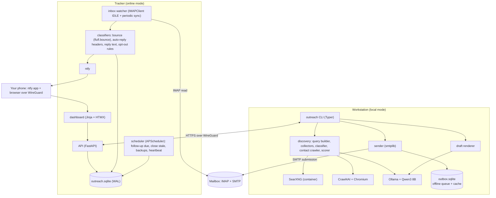
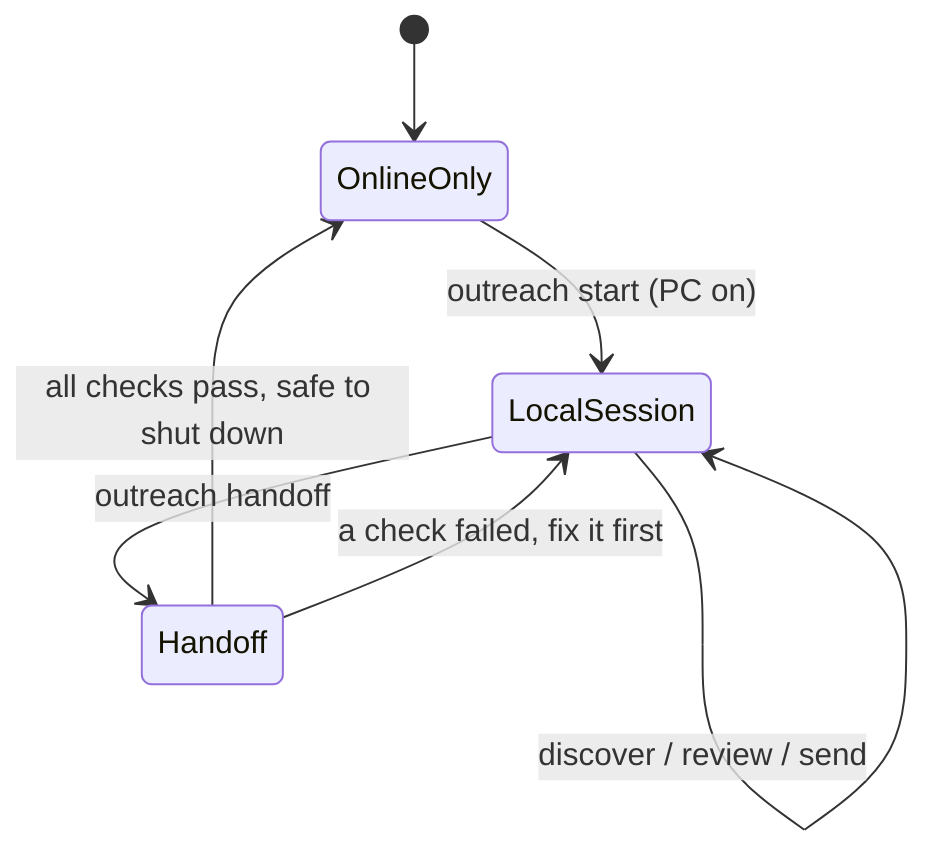
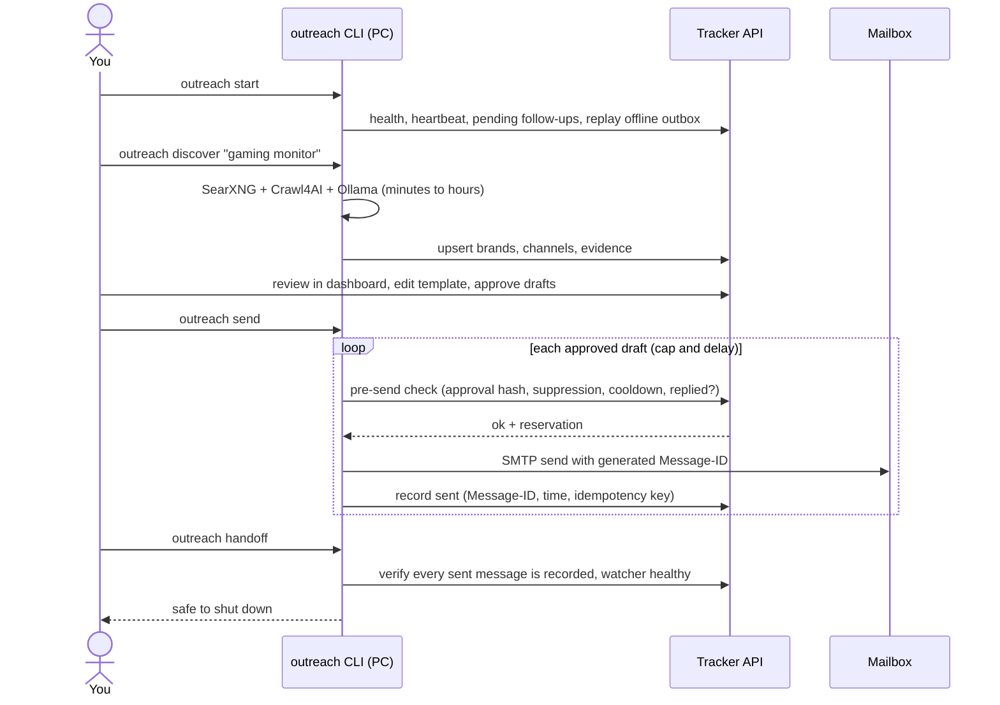

# 2. Architecture

## Two nodes, one source of truth

| | **Workstation** (local mode) | **Tracker** (online mode) |
|---|---|---|
| Hardware | Your Windows PC: 16 GB RAM, RTX 5060 8 GB | Always-on small machine: Oracle Cloud Always Free ARM VM, or a Raspberry Pi or old laptop at home |
| When it runs | Only when you start it | 24/7 |
| Does | Brand discovery, contact crawling, AI classification and hooks, rendering drafts, **sending** approved email and follow-ups | **Tracking only**: watch the inbox, match replies, detect bounces and opt-outs, maintain suppression, flag follow-ups as due, alert your phone, serve the dashboard |
| Never does | Store the master copy of data (it keeps only caches and an outbox) | Find contacts, run the crawler, call an LLM for writing, or **send email** |
| Holds secrets | SMTP credential (to send) | IMAP credential (to read) |
| Software | `outreach` CLI (Python), SearXNG, Crawl4AI with headless Chromium, Ollama | `outreach-tracker` service (Python: FastAPI, SQLite, APScheduler, IMAPClient), ntfy |

The **tracker's SQLite database is the single source of truth**. The workstation reads and writes it through the tracker's HTTP API over a private WireGuard network. There is no two-way database sync, so there are no merge conflicts. See [Data model and sync](04-data-model-and-sync.md).

Why not keep the master copy on the PC? Tracking must keep writing (replies, bounces) while the PC is off, so the always-on node has to own the data. The PC is the occasional client.

## Components

## Modes and the handoff

You asked for a system that does the heavy work locally, then "switches to online mode" for tracking. In this design, **online mode is always running**. Local mode is a session you open and close. The "switch" is an explicit **handoff check** at the end of a local session.

### A typical local session

### Handoff checks (`outreach handoff`)

1. The offline outbox is empty: every local write reached the tracker.
2. Every message sent this session has a tracker record with its `Message-ID`.
3. The tracker's inbox watcher heartbeat is under 15 minutes old and its last IMAP sync succeeded.
4. No message is stuck in `sending` or `unknown`. If one is, it is reconciled against the mailbox's Sent folder first.
5. Optional: pull a fresh database backup to the PC (see [Deployment](07-deployment-and-security.md#backups)).

If any check fails, the CLI says what to fix and does not report "safe to shut down".

### What online mode does while the PC is off

| Every | Job |
|---|---|
| Continuous | IMAP IDLE on INBOX, renewed every 10 minutes |
| 15 min | Full incremental sync by UID (catches anything IDLE missed) |
| 15 min | Write the heartbeat |
| 1 hour | Mark follow-ups **due** (no reply after N days). Due follow-ups are **not sent**: the next local session shows them for approval |
| Daily | Close threads with no reply N days after the follow-up; database backup; prune old raw email copies |
| On event | Push a phone alert through ntfy (reply received, bounce-rate pause, watcher failing) |

## Failure behaviour

| Failure | Behaviour |
|---|---|
| Tracker unreachable while sending | Sending stops (fail closed). Discovery keeps going and queues writes in the local outbox |
| PC crashes mid-send | The message stays `sending`. On the next session the CLI checks the Sent folder over IMAP by `Message-ID` before any retry, so there are no duplicates |
| Tracker down for hours | Replies wait in the mailbox. On restart, the UID sync catches up from the last stored UID |
| Mailbox `UIDVALIDITY` changes | A bounded resync: rescan the last 30 days, deduplicated by `Message-ID` |
| IMAP credential revoked | Watcher alerts by ntfy and the dashboard shows a red banner. Sending is blocked until tracking works again |
| Bounce rate at least 5% of the last 20 sends | Tracker sets a global pause flag, and the PC refuses to send until you clear it |

## Why this shape

- **No proprietary platform in the core.** The v0 kit relies on Google Apps Script and Sheets. This design replaces them with software you can run anywhere.
- **Small always-on footprint.** The tracker needs well under 1 GB RAM, so it fits a free VM or a Raspberry Pi.
- **Heavy work stays on the GPU you already own.** Crawling and the LLM would not fit a free server, and they don't need to run 24/7.
- **Clear write ownership.** The PC writes discovery, drafts and sends. The tracker writes inbound events, suppression and follow-up state. Two writers never touch the same fields (see [ownership table](04-data-model-and-sync.md#write-ownership)).
