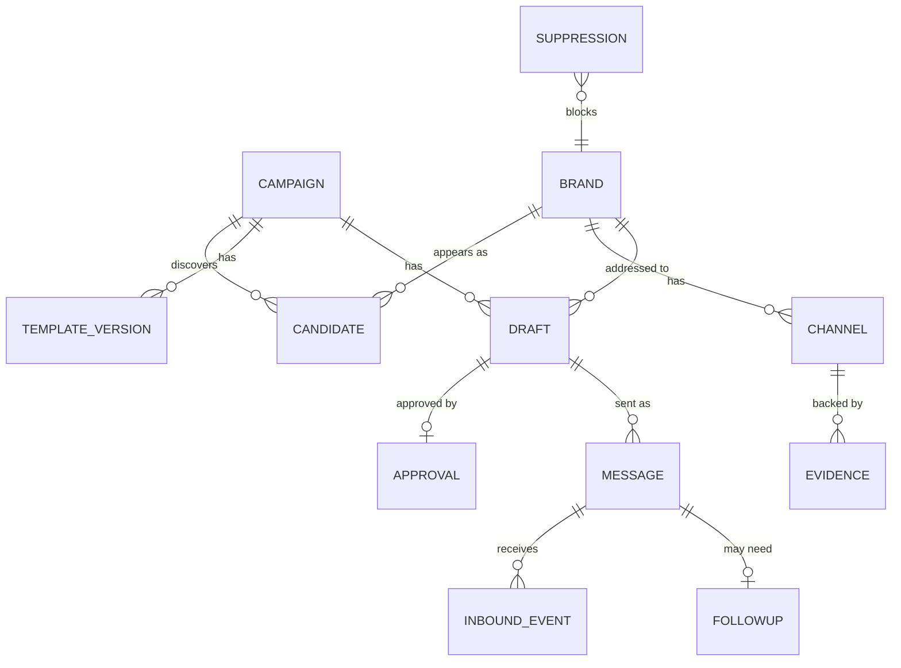
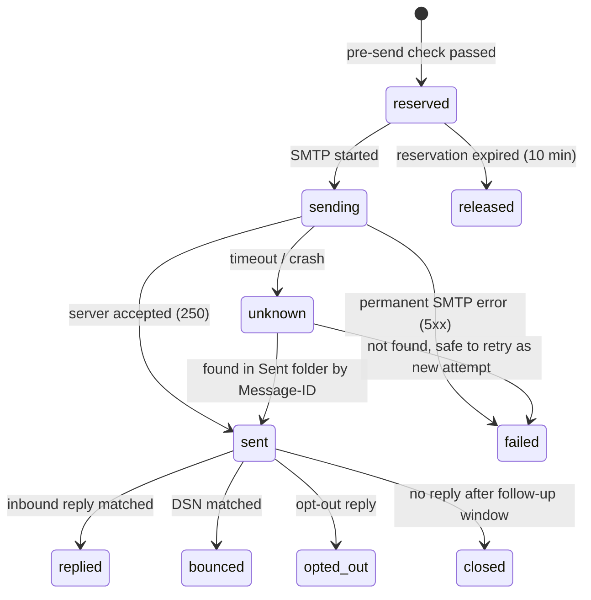

# 4. Data model and sync

## Principles

- **One master database** on the tracker (`outreach.sqlite`, WAL mode). The PC never holds a second master copy.
- **The PC talks to the tracker API**, never to the database file directly.
- **Each field has exactly one writer** (PC or tracker), so there are no conflicts to merge.
- **Every write from the PC carries an idempotency key**, so retries after a network drop are safe.
- **IDs are UUIDv7** (time-ordered), generated by whichever side creates the row, so the PC can create rows offline.
- Times are stored in UTC. The dashboard shows Asia/Kolkata.

## Entities



| Table | Key columns | Notes |
|---|---|---|
| `campaigns` | id, category, synonyms (JSON), review_topics (JSON), status, created_at | One per product type and run |
| `brands` | id, **domain (unique)**, name, website, country, brand_type, tier, last_contacted_at | Deduplicated by registrable domain across all campaigns |
| `candidates` | id, campaign_id, brand_id, relevance, audience_fit, contact_quality, score, status (`new`, `classified`, `rejected`, `promoted`), classification (JSON) | A brand's appearance in one campaign |
| `channels` | id, brand_id, type (`email`, `form`, `program`, `social`), value, role (`creator_pr`, `general`, `support`, `person`), verification (`published_mx_ok`, `published_no_mx`, `unconfirmed`), is_primary, checked_at | Exactly one primary channel per brand per campaign |
| `evidence` | id, channel_id, source_url, excerpt, fetched_at, content_hash | Proof for every channel (invariant 3) |
| `template_versions` | id, campaign_id, version, subject, body, follow_up_body, created_at | Immutable; editing creates a new version |
| `drafts` | id, campaign_id, brand_id, channel_id, template_version_id, hook, subject, body, **content_hash**, status | Rendered text; `content_hash` = SHA-256 of recipient + subject + body |
| `approvals` | id, draft_id, **approved_hash**, approved_at, batch_id | Valid only while `approved_hash == drafts.content_hash` |
| `messages` | id, draft_id, kind (`initial`, `followup`), **rfc_message_id (unique)**, in_reply_to, to_addr, idempotency_key (unique), state, sent_at, error | One row per email sent or attempted |
| `inbound_events` | id, message_id (nullable), imap_uid, uidvalidity, rfc_message_id (unique), from_addr, received_at, type, classification, confidence, snippet, reviewed | Replies, bounces, auto-replies, opt-outs |
| `followups` | id, message_id, due_at, state (`scheduled`, `due`, `approved`, `sent`, `cancelled`) | The tracker flags due; the PC sends |
| `suppressions` | id, value, type (`email`, `domain`), reason, source_event_id, created_at | Never deleted automatically |
| `settings` | key, value | Caps, delays, cooldown, pause flag |
| `audit_log` | id, at, actor (`pc`, `tracker`, `user`), action, entity, entity_id, details (JSON) | Append-only |
| `heartbeats` | component, at, status, detail | Watcher, scheduler, last IMAP sync |

### Message state machine



`sent` means the provider accepted the message, not that it was delivered. Delivery is only ever inferred from a reply, or the absence of a bounce.

## Write ownership

| Data | Written by PC | Written by tracker | Written by you (dashboard) |
|---|---|---|---|
| campaigns, candidates, brands, channels, evidence | ✓ | | edits, merges, exclusions |
| template_versions, drafts | ✓ (render) | | edits (creates new version or draft) |
| approvals | | | ✓ |
| messages: create, `reserved` → `sent`/`failed`/`unknown` | ✓ | | |
| messages: `sent` → `replied`/`bounced`/`opted_out`/`closed` | | ✓ | manual override |
| inbound_events | | ✓ | reclassify |
| followups: schedule, mark due, cancel | | ✓ | approve |
| followups: `approved` → `sent` | ✓ | | |
| suppressions | | ✓ (bounce, opt-out) | ✓ (manual, declines) |
| settings, pause flag | | ✓ (bounce-rate pause) | ✓ |

## Sync protocol (PC ↔ tracker)

### Online (normal)

The PC calls the REST API directly:

```
POST /api/v1/campaigns
POST /api/v1/candidates:batchUpsert      (idempotency key per batch)
POST /api/v1/drafts:render
POST /api/v1/messages:reserve            → checks + reservation token
POST /api/v1/messages/{id}:markSent      (rfc_message_id, sent_at)
POST /api/v1/messages/{id}:markFailed
GET  /api/v1/followups?state=approved
GET  /api/v1/health                      → watcher heartbeat, last sync, pause flag
```

### Offline (tracker unreachable)

- Discovery results go to `outbox.sqlite` on the PC as a queue of API calls, each with its idempotency key.
- On the next connection, `outreach start` replays the queue in order. The server ignores keys it has already applied.
- **Sending never runs offline** (fail closed). The PC cannot check suppression, replies or approvals, and must not guess.

### The pre-send check (`messages:reserve`)

Runs on the tracker in a single transaction. It refuses unless all of these hold:

1. The draft has an approval whose `approved_hash` equals the current `content_hash`.
2. The recipient's email and domain (website domain, or the email itself for free-mail addresses) are not suppressed.
3. No other first-email went to this brand domain inside the cooldown window.
4. No reply or opt-out has been recorded for this brand in this campaign.
5. Today's count (initial + follow-up) is below the current cap, and the global pause flag is off.
6. No other reservation is open for this draft.

On success it creates a `messages` row in `reserved` state with a fresh `rfc_message_id` and returns it. The PC must use that exact `Message-ID` in the email. That is what lets the tracker match replies later.

## Retention

- Inbound emails: keep headers, a 500-character snippet and the classification. Raw bodies are optional and pruned after 30 days.
- Evidence excerpts are kept for as long as the channel exists.
- Exports: CSV or JSON of every table from the dashboard. Delete-all is a CLI command with a confirmation.
