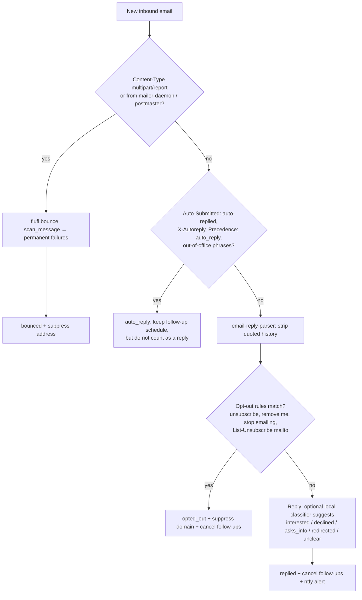

# 5. Email sending and tracking

## Account setup

- Use a **dedicated outreach mailbox** (for example `yourchannel.collabs@gmail.com`), not your personal account. An app password unlocks the whole mailbox, so keep the blast radius small.
- Turn on 2-Step Verification, then create **two app passwords**: one for the PC (SMTP sending) and one for the tracker (IMAP reading). Each can be revoked on its own.
- Accounts enrolled in Google's Advanced Protection cannot use app passwords.
- Any other provider with IMAP and SMTP works the same way. Only the host names and credentials change.

## Sending (PC, local mode)

```
for each approved draft, highest score first:
    reservation = tracker.reserve(draft)          # pre-send check (see data model doc)
    msg = build_mime(draft, message_id=reservation.rfc_message_id)
    tracker.mark_sending(reservation)
    smtp.send_message(msg)                        # smtp.gmail.com:587 STARTTLS
    tracker.mark_sent(reservation, sent_at)
    sleep(delay_seconds)
```

- **Plain-text body**, `Content-Type: text/plain; charset=UTF-8`, one recipient per message, never CC or BCC.
- **`Message-ID` comes from the tracker's reservation**, in the form `<uuid@your-domain-or-local>`. This header links every later reply back to the message.
- **`List-Unsubscribe`**: include a `mailto:` header pointing to the outreach address with subject "unsubscribe". Gmail and other clients show an unsubscribe link, and the tracker treats those emails as opt-outs.
- Gmail's SMTP server saves a copy in **Sent** automatically. The tracker can use this to reconcile `unknown` messages.
- **Follow-ups** are sent the same way with `In-Reply-To` and `References` set to the original `Message-ID`, and the subject prefixed with `Re: `, so they thread in the brand's mail client.
- **Retry policy:** temporary 4xx errors retry with exponential backoff (at most 3 tries). Permanent 5xx errors are not retried and are marked `failed`. On a timeout the message is marked `unknown` and checked in the Sent folder **before** any retry.
- On repeated authentication errors or a rate-limit response, the PC stops and sets the pause flag.

## Volume limits

| Limit | Value | Source |
|---|---|---|
| Gmail personal account hard cap | 500 recipients a day; going over suspends sending for up to 24 h | Vendor guides (verify on Google's help pages) |
| Safe cold-outreach volume for a new free Gmail | Roughly 20–40 a day | Vendor guides |
| **This system's default** | **10 a day in week 1, +5 a week, ceiling 30**, follow-ups included | Our choice: protect sender reputation |
| Delay between sends | 30–60 s with random jitter | Our choice |
| Brand cooldown | 60 days between first-emails to one domain | Our choice |
| Bounce auto-pause | 5% or more of the last 20 sends | Our choice |

At 10 a day, 150 brands take about 2–3 weeks, so the queue always sends the highest-ranked brands first.

## Tracking (tracker, online mode)

### Inbox watcher

- **IMAPClient** connects to `imap.gmail.com:993` (TLS) and selects `INBOX`.
- **IDLE** for push-style notices, renewed every **10 minutes** (IMAPClient's advice; the RFC 2177 maximum is 29). Handle dropped sockets by reconnecting with backoff.
- **Incremental sync** every 15 minutes: fetch UIDs greater than the last stored UID. If `UIDVALIDITY` changes, rescan the last 30 days, deduplicated by `Message-ID`.
- Fetch headers plus the first part of the body. Store the snippet, never attachments.
- Mark nothing as read and move nothing. The tracker is read-only toward the mailbox, so it never changes what you see in Gmail.

### Matching an inbound email to a sent message

In this order:

1. `In-Reply-To` or any `References` entry equals a stored `messages.rfc_message_id` → **strong match**.
2. A bounce report (DSN) contains the original `Message-ID` or the recipient address → **bounce match**.
3. Sender's domain equals a contacted brand's domain **and** the subject contains the original subject → **weak match**, shown as "needs confirmation" on the dashboard.
4. Anything else is ignored. An unrelated email from the same domain never marks a brand as replied.

### Classification pipeline



- Classification only **suggests**. You can correct it in the dashboard.
- A suggested `declined` adds a domain suppression **only after you confirm**, because keyword guesses are risky.
- Temporary bounces (`all_failures` reports them separately) do not suppress. They retry once on the next local session.
- Optional reply classifier: rule-based by default. A very small local model on the tracker is possible but not required. The tracker must stay light.

### Follow-ups

- Scheduled at `sent_at + 7 days` (configurable). At most **one** follow-up per brand.
- The tracker marks it **due** only if there is no reply, opt-out or bounce. It never sends.
- The next local session lists due follow-ups. You approve them, and the PC sends them in-thread.
- A thread is marked `closed` 14 days after the follow-up with no reply.

## Bounce-rate protection

After every bounce, the tracker computes bounces among the last 20 sent messages. At 5% or more it sets `settings.paused = true` and sends an ntfy alert. The PC refuses to send until you review the addresses and clear the pause.

## Why not self-host the mail server

Self-hosted servers (Stalwart, Mailcow, Mailu and others) are open source, but new IPs and domains have no sender reputation. Many cloud IP ranges are blocklisted, and Oracle and other clouds often block outbound port 25. Cold email from a fresh self-hosted server mostly lands in spam. Using an established mailbox **over open protocols** keeps the software open while giving your emails a fair chance of being read. The design stays provider-neutral, so you can move later.

## Sources

- Gmail limits and SMTP: [Woodpecker sending limits](https://woodpecker.co/blog/email-sending-limits/), [Prospeo Gmail SMTP limits 2026](https://prospeo.io/s/gmail-smtp-limits), [Reply.io Gmail limits 2026](https://reply.io/blog/gmail-sending-limits/), [Nylas Gmail SMTP settings](https://developer.nylas.com/docs/cookbook/email/gmail-smtp-settings.md)
- App passwords and less secure apps: [Google Workspace updates](https://workspaceupdates.googleblog.com/2023/09/winding-down-google-sync-and-less-secure-apps-support.html), [Nylas app password setup](https://cli.nylas.com/guides/gmail-app-password-setup.md)
- IMAP IDLE: [IMAPClient advanced usage](https://imapclient.readthedocs.io/en/master/advanced.html), [Rust imap crate idle docs](https://docs.rs/imap/0.10.0/src/imap/extensions/idle.rs.html)
- Bounces: [flufl.bounce docs](https://fluflbounce.readthedocs.io/en/latest/using.html)
- Reply extraction: [email-reply-parser](https://openapps.pro/packages/email-reply-parser), [Talon reply extraction comparison](https://docs.agentmail.to/talon-reply-extraction)
