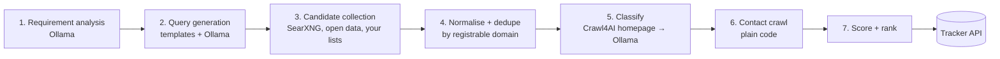

# 6. Discovery pipeline (local mode)

Goal: from a product type such as "gaming monitor", produce 30–150 ranked brands, each with its best published contact channel and the evidence behind it, using **only open-source software and open data**.

The v0 script (`discovery/discover.py`) already does steps 4–6 with Crawl4AI. v1 replaces Gemini (proprietary) with SearXNG + Ollama, and adds checkpoints and the tracker API.

## Stages



Every stage writes a **checkpoint** (stage, cursor, counts), so a run can stop and resume. A run may take minutes or a few hours, and that's fine because it uses the PC only when you choose.

### 1. Requirement analysis

Ollama turns free text into editable JSON: category, synonyms, sub-types, regions, review topics. It must ask for missing profile facts (channel link, subscriber count, sample video) rather than invent them.

### 2. Query generation

Templates × synonyms × regions × sub-types, for example:

- `best {synonym} brands {year}`, `{synonym} manufacturer`, `{synonym} brand India`
- `{sub-type} {synonym} brand` (for monitors: "OLED gaming monitor brand", "budget 144Hz monitor brand")
- `site:reddit.com {synonym} brands`, `{synonym} brand creator program`

Expect 100–300 queries per category. Results are **leads, not proof**.

### 3. Candidate collection (all open)

| Source | How | Notes |
|---|---|---|
| **SearXNG** on the PC | JSON API, a few queries a second at most, home IP | Primary lead source. Collect result domains, plus brand names from list articles |
| **Brand lists in articles** | Crawl4AI fetches top "best X brands" articles; Ollama extracts brand names and official URLs from the text | Text is untrusted. Names are verified at stage 5 |
| **Wikidata** (open data, CC0) | SPARQL: companies whose products are instances of the category (manufacturer / product-type properties). Exact item and property IDs to be confirmed on wikidata.org | Good for established brands, weak for small ones |
| **Community wikis and lists** | For example the Deskthority wiki for keyboards; subreddit wikis | Check each site's terms; prefer manual export |
| **Your own CSV** | `name,website` | Always allowed, highest trust |
| **Retailer brand filters** | You copy brand names by hand from Amazon.in or Flipkart filters into your CSV | Don't scrape retailers; their terms usually forbid it |

### 4. Normalise and deduplicate

- Registrable domain via the Public Suffix List (`tldextract`, BSD-3), so `en.akkogear.com` and `akkogear.com` count as one brand.
- Drop marketplaces, retailers and review sites (a maintained denylist).
- A manual merge in the dashboard handles brands with several domains.

### 5. Classify

- Crawl4AI fetches the homepage plus the "about" page, honouring robots.txt.
- Ollama with a Pydantic schema returns `brand_type`, `sells_category`, `tier` (A/B/C), `product_line` and a `hook` grounded in the page text.
- The page text is wrapped as untrusted data, and the prompt says to ignore instructions inside it.
- Tier C (marketplace-only, white-label) is hidden by default.

### 6. Contact crawl (plain code, no LLM)

Already proven in v0 on 15 real keyboard brands (10 published emails found in about 2 minutes):

- Follow homepage links matching contact, about, press, media, partner, creator, influencer, affiliate, ambassador or collab, plus fallbacks `/contact`, `/contact-us`, `/pages/contact`. At most 6 pages per brand.
- Extract `mailto:` links, visible addresses, `(at)` obfuscation, and Cloudflare `data-cfemail`.
- Drop junk (`noreply`, image filenames, tracking domains).
- Rank addresses by role: creator/PR > general > named person > support. Same domain is a bonus, a different domain a penalty.
- Contact forms count only if they have a message box (a lone email field is usually a newsletter sign-up).
- Program links exclude product pages, blog or news or press articles, and homepages.
- MX check with dnspython. It shows the domain accepts mail, not that the mailbox exists. **Never** probe mailboxes over SMTP.

### 7. Score

```
score = tier (A 40 / B 30 / C 5)
      + contact (creator/PR email 50, general 35, form or program 15–20, support 20, none 5)
      + audience_fit (0–10, from category vs your channel)
      − 30 if the brand does not sell the category
```

Higher scores are contacted first, because the daily cap means order matters.

## Operating limits (16 GB RAM PC)

- 4–6 concurrent pages, one at a time per domain, 20 s timeouts, response size cap.
- Crawl4AI's cache avoids refetching. Re-check contacts only if older than 30 days.
- Back off on 403 or 429 errors and skip the domain after repeated blocks. Never bypass logins or CAPTCHAs.
- Ollama runs one request at a time with the model held in VRAM. Don't run games while discovering.

## Measuring quality

For each category keep a hand-made list of 15 known brands with their real contact pages. After each run, report:

- recall (how many of the 15 were found),
- contact precision (whether each reported email really appears on the cited page),
- coverage curve (new brands per extra query batch), which tells you when "Find more" stops paying off.
