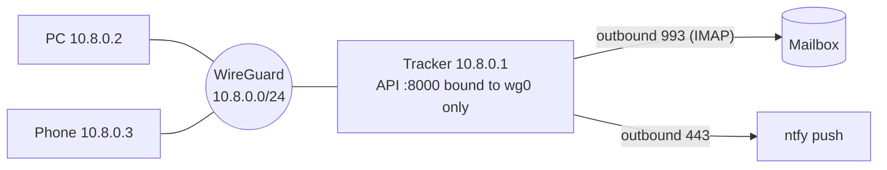

# 7. Deployment and security

## Where the tracker runs

The tracker needs about 1 vCPU, under 1 GB RAM, a few GB of disk and an always-on internet connection.

| Option | Cost | For | Against |
|---|---|---|---|
| **A. Oracle Cloud Always Free, Ampere A1 (ARM)** | ₹0 | Real always-on server with a public IP. Oracle's docs now give **1,500 OCPU-hours and 9,000 GB-hours a month, equal to 2 OCPUs and 12 GB RAM**, plus 200 GB block storage and 5 volume backups | **Idle reclamation**: an instance can be reclaimed if, over 7 days, 95th-percentile CPU, network **and** (on A1) memory are all under 20%. A light tracker *is* idle by that test. ARM capacity in popular regions can run out. Needs a card for sign-up |
| A2. Oracle AMD micro (E2.1.Micro) | ₹0 | Up to two VMs, each 1/8 OCPU and 1 GB RAM | Very small; fine for the tracker alone; same reclamation rules |
| **B. Device at home** (Raspberry Pi 4/5, old laptop, or a spare Android phone running Linux) | Electricity only | Fully yours, no reclamation, data never leaves home | Depends on home power and internet; needs a WireGuard path in, or an outbound-only design |
| C. GitHub Actions cron | ₹0 (public repo) | No server | **Rejected**: schedules in public repos are disabled after 60 days without repo activity; no persistent state; secrets in CI |
| D. Paid VPS (~₹300–500/month) | Low | Simple and reliable | Not free |

**Recommendation:** start with **B** if you have a spare device. Otherwise use **A** and handle idle reclamation:

- Upgrading the Oracle account to Pay-As-You-Go (still ₹0 within Always Free limits) is widely reported to exempt instances from idle reclamation. **Verify** this in Oracle's current terms before relying on it.
- Don't burn CPU on purpose to look busy. It's wasteful and may break the terms.

Because the tracker is plain Python + SQLite, moving between A, B and D is a copy of one folder and one database file.

## Packaging

- **Tracker:** one container image (or a `systemd` service with a venv) running `outreach-tracker`. Multi-arch build (arm64 + amd64). Optional second container for ntfy.
- **PC:** `pipx install outreach` (or a venv); SearXNG in Podman or WSL2 Docker Engine; Ollama installed natively for GPU access. Docker Desktop is avoided because its license is proprietary.
- Pin every version. Use `uv` or `pip-tools` lock files. Renovate or Dependabot keep them up to date.

## Network

- The API, dashboard and ntfy listen **only on the WireGuard interface**. The cloud firewall allows inbound UDP for WireGuard and nothing else (plus SSH with keys only, ideally also limited to WireGuard).
- A home tracker behind a router: the tracker can be the WireGuard **client** connecting out to the PC when the PC is on, plus ntfy for alerts. Or forward one UDP port. Pick one in milestone M3.
- TLS inside WireGuard is optional, since WireGuard already encrypts. Use Caddy (Apache-2.0) if you want HTTPS names.

## Secrets

| Secret | Where | Protection |
|---|---|---|
| SMTP app password | PC only | OS keyring (Windows Credential Manager via `keyring`, MIT), never in files |
| IMAP app password | Tracker only | `systemd` credential or a root-only env file; encrypted at rest with a key stored apart from backups |
| API token (PC → tracker) | Both | Random 256-bit token, rotated with one CLI command |
| WireGuard keys | Each device | Generated per device, never copied |
| Dashboard login | Tracker | Single user, Argon2 password hash, session cookie, CSRF tokens |

- Secrets never go into the database, logs, Git or exports. Logs redact email bodies by default.
- Separate app passwords for PC and tracker mean either can be revoked alone.
- If the tracker is compromised, the attacker can read the outreach mailbox but **cannot send**: there is no SMTP credential on the tracker. This is a deliberate benefit of the split.

## Backups

- **Nightly** on the tracker: `sqlite3 outreach.sqlite ".backup …"` into a dated file; keep 14.
- **Each local session**: `outreach start` pulls the latest backup to the PC, so a second copy lives off the server.
- Oracle option: 5 free volume backups as a third layer.
- **Restore drill** (milestone M5): restore yesterday's backup into a fresh tracker and confirm the dashboard and the watcher cursor resume correctly.

## Observability

- `/api/v1/health` reports the watcher heartbeat, last IMAP sync, queue counts and the pause flag.
- The dashboard shows a red banner if the heartbeat is older than 30 minutes, IMAP authentication fails, or the pause flag is on.
- ntfy alerts for the same conditions, so you hear about problems while the PC is off.
- Structured JSON logs with rotation; no third-party telemetry.

## Threat checklist

- Prompt injection from web pages and inbound email: content is wrapped as data; the LLM can never call send or suppress; outputs are schema-validated.
- A replayed or forged API call: token auth over WireGuard only; idempotency keys; every send is gated by `messages:reserve`.
- Sending too much by mistake: caps, cooldown, bounce-rate pause and kill switch, all enforced on the tracker, not just the PC.
- A lost PC: revoke its WireGuard peer, API token and SMTP app password. The tracker and its data are unaffected.

## Sources

- [Oracle Always Free resources (official)](https://docs.oracle.com/en-us/iaas/Content/FreeTier/resourceref.htm)
- Allowance change reports: [labmemo](https://labmemo.com/?p=55273), [issoh](https://www.issoh.co.jp/tech/details/17531/), [braindetox](https://braindetox.kr/en/posts/oracle_always_free_tier_reduced_2026.html)
- ARM capacity and free VPS notes: [klymentiev](https://klymentiev.com/blog/free-vps), [space-node](https://space-node.net/blog/oracle-cloud-free-vps-guide-2026)
- [GitHub Actions: disable and enable workflows](https://docs.github.com/en/actions/how-tos/manage-workflow-runs/disable-and-enable-workflows)
