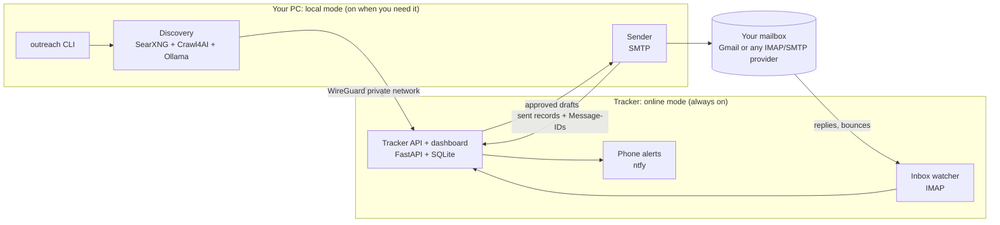

# OutreachAI design documentation

Design for the next version of this project: a **fully open-source** outreach system for a YouTube creator who asks brands for review units.

- **Local mode.** Heavy work (brand discovery, contact extraction, AI, sending) runs on your own PC when you turn it on.
- **Online mode.** A small always-on server does only **tracking**: replies, bounces, opt-outs and follow-up reminders. It never finds contacts and never sends email.

> Status: design only (31 October 2026). Nothing in these documents is implemented yet. The working code in `apps-script/` and `discovery/` is the v0 starter kit described in the [roadmap](09-roadmap.md).

## Reading order

| # | Document | What it answers |
|---|---|---|
| 1 | [Goals and principles](01-goals-and-principles.md) | What the system must do, what "completely open source" means here, and the safety rules that never change |
| 2 | [Architecture](02-architecture.md) | The two nodes, what runs where, and how local mode hands over to online mode |
| 3 | [Technology choices](03-technology-choices.md) | Every component, the options compared, their licenses, and the decision |
| 4 | [Data model and sync](04-data-model-and-sync.md) | The database, who owns which data, and how the PC and server stay in step |
| 5 | [Email sending and tracking](05-email-sending-and-tracking.md) | SMTP sending, IMAP tracking, threading, bounces, replies, follow-ups, limits |
| 6 | [Discovery pipeline](06-discovery-pipeline.md) | Finding brands and contacts with no paid or closed services |
| 7 | [Deployment and security](07-deployment-and-security.md) | Where the tracker runs, private networking, secrets, backups |
| 8 | [Licensing and compliance](08-licensing-and-compliance.md) | The project license, dependency licenses, attribution duties, outreach law |
| 9 | [Roadmap](09-roadmap.md) | Milestones, migration from the v0 kit, open questions |

## The design in one picture

## Key decisions at a glance

1. **The tracker's database is the single source of truth.** The PC reads and writes it over a private network. No two-way sync and no merge conflicts.
2. **Email goes over open standards (SMTP and IMAP), not a vendor API.** Gmail works through an app password, and any other provider works the same way.
3. **Replies are matched by the standard `Message-ID` / `In-Reply-To` headers**, not by Gmail thread IDs, so the system is not tied to Gmail.
4. **Everything we run is OSI-licensed:** SearXNG, Crawl4AI, Ollama, an Apache-2.0 model, FastAPI, SQLite, IMAPClient, WireGuard and ntfy. Proprietary pieces are optional adapters, never required.
5. **Fail closed.** If the PC cannot reach the tracker, it refuses to send, because it cannot check suppression and reply state.
